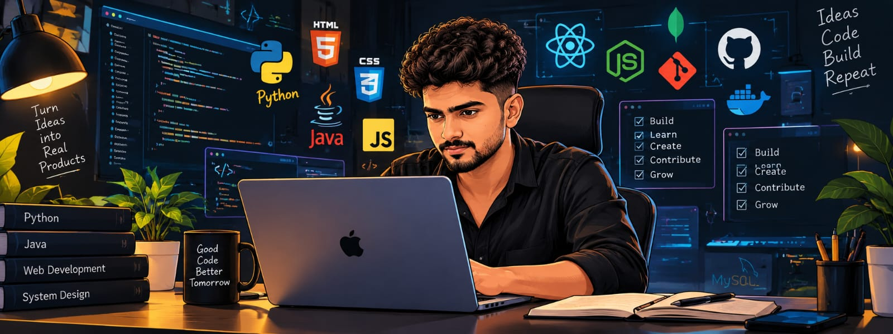

  

<h1 align="center">👋 Hi, I'm Senin</h1>

  AI &amp; Data Science Engineer · Software Engineer Intern @ <a href="https://senin.in/#experience">Metadesign Software Solutions</a>

  <b>Computer Vision • Conversational AI • Backend Engineering • Kerala, India</b>

  
  
  
  

## 🙋 About me

I'm an AI & Data Science engineer from Kerala, India, who turns machine learning into software people can rely on. My work ranges from real-time computer vision pipelines with YOLO and OpenCV to conversational assistants that switch between Malayalam and English.

- 💼 **Working:** Software Engineer Intern at **Metadesign Software Solutions**, Pune (since June 2026), building the backend of a movie booking system: transactional seat reservation, database schema and REST APIs.
- 🎓 **Studied:** B.Tech in Artificial Intelligence & Data Science at **MES College of Engineering, Kuttippuram** (KTU, 2022–2026), 8.22 CGPA, First Class with Distinction.
- 📚 **Learning:** Agentic AI (DeepLearning.AI · Coursera).
- 🏆 **Hackathons:** 2nd prize at Matrix Hackathon (MESCE, 2024) and 3rd prize at Kotech Hackathon (Kottakkal, 2025).
- 🎤 **Community:** ran the *Prompt to Code* generative AI workshop for 100+ students, and hosted the ARCANE vibe-coding challenge.

## 🧰 Skills

| Area | Tools |
| --- | --- |
| **AI, Vision & ML** | Python, OpenCV, TensorFlow, PyTorch, YOLOv8, LBPH face recognition, Scikit-Learn, Prompt Engineering |
| **Frontend & Full-Stack** | React, TypeScript, JavaScript, Next.js, TailwindCSS, HTML5 |
| **Backend, APIs & Data** | FastAPI, Node.js, REST APIs, PostgreSQL, SQLite, Git, Linux |
| **Engineering** | Data Structures & Algorithms, Computer Vision Pipelines, System Architecture, Performance Optimisation |

## 🛠️ Things I've built

| Project | What it is |
| :---: | --- |
| [**Mentora**](https://senin.in/#work) | An AI faculty advisor parents can talk to at any hour. It's a 24/7 bilingual assistant that speaks Malayalam and English, built with FastAPI, speech AI and RAG. [Code](https://github.com/SeninAshraf/Mentora) |
| [**Automated Attendance System**](https://senin.in/#work) | Attendance that recognises faces and student ID cards in real time, using OpenCV LBPH face recognition and YOLO, with database sync. Written up as a paper. [Code](https://github.com/SeninAshraf/Automated-Attendance-System) |
| [**GUIDANCE**](https://senin.in/#work) | An AI career companion that builds personalised career roadmaps, runs mock interviews and improves résumés. Built with React and Node.js. [Code](https://github.com/SeninAshraf/GUIDANCE) |
| [**Meeting Analyst**](https://senin.in/#work) | A Chrome extension that records, transcribes and summarises Google Meet and Zoom calls, then pulls out the action items. [Code](https://github.com/SeninAshraf/Meeting-Analyst) |
| [**Booking System**](https://senin.in/#work) | Reservation and booking management in Python with a relational schema, authentication, an availability calendar and automated notifications. [Code](https://github.com/SeninAshraf/booking_system) |
| [**GenArchAI**](https://senin.in/#work) | A generative-AI design explorer that helps engineers structure cloud solutions, weigh trade-offs and draft system blueprints. [Code](https://github.com/SeninAshraf/GenArchAI) |

## 📊 GitHub Activity

  

